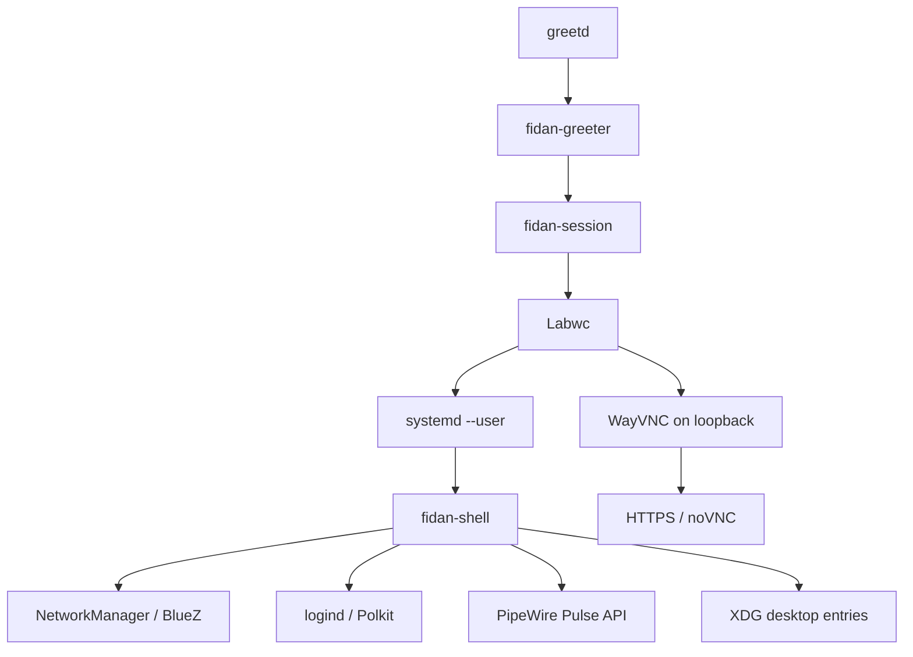

# Architecture

## Runtime

`greetd` starts `fidan-greeter` inside Cage. After authentication it launches
`fidan-session`, which starts Labwc with the Project Fidan configuration.
Labwc's autostart imports the Wayland environment into the systemd user manager
and starts `fidan-session.target`. The target supervises `fidan-shell`.

The shell creates independent background, panel, dock, launcher, quick-settings
and notification Layer Shell surfaces. When LayerShellQt is unavailable, the
same components can run in a normal preview window; the production image makes
LayerShellQt mandatory.

For a Pi without a monitor, Labwc creates the `NOOP-fidan` fallback output.
WayVNC exports that output over a loopback-only socket. An authenticated HTTPS
gateway serves noVNC at `fidan.local`, so first boot and the later desktop can
be reached from a browser on the same local network. See
[headless management](headless-management.md) for the provisioning flow and
security boundaries.

## Privilege boundaries

The shell is unprivileged. Network and power operations use established D-Bus
services. First boot is split between an unprivileged fullscreen client and the
root `fidan-firstbootd` service. D-Bus policy restricts the service to the
dedicated setup account; inputs are validated before fixed-path system tools are
invoked. Passwords are written to child-process stdin and are not placed in
arguments, files or logs.

## Build and packaging

CMake builds three Qt applications and the privileged service. Debian packages
split shell, session, greeter, lock, first boot and artwork so that each can be
updated independently. The `fidan-desktop` metapackage selects the complete
desktop and the lightweight default applications.

`rpi-image-gen` v2.8.0 composes the Raspberry Pi OS Trixie base, Pi 5 hardware
layer, Fidan packages and first-boot policy into the disk image. The custom layer
is declarative; its hook only performs target-root configuration that Debian
package maintainer scripts cannot determine at package build time.

